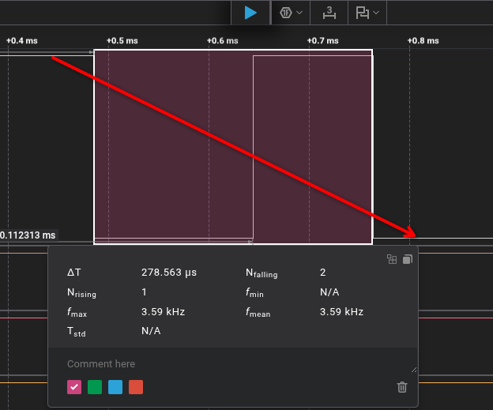
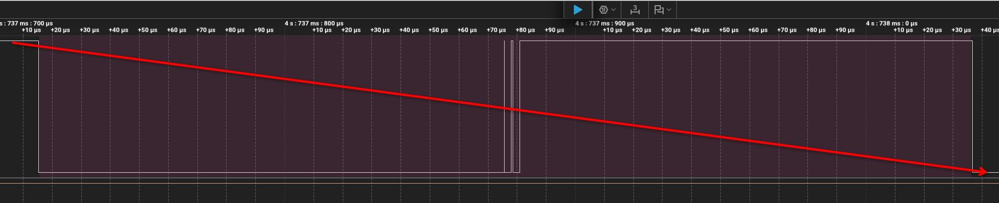
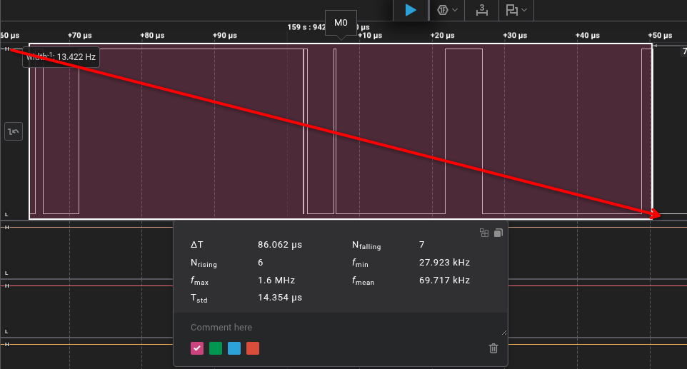

# Модуль 1.5. Сигнали та Кнопка: Що бачить осцилограф, коли натискаєш кнопку?

## Домашнє завдання: Дослідження брязкоту контактів кнопки за допомогою логічного аналізатора та мікроконтролера

---

## 1. Мета роботи

1. Експериментально дослідити фізичне явище брязкоту контактів (contact bounce / chatter) тактової кнопки під час замикання та розмикання.
2. Зареєструвати форму реального електричного сигналу за допомогою логічного аналізатора та виміряти часові характеристики брязкоту (тривалість, кількість сплесків).
3. Порівняти кількість зареєстрованих переходів логічного аналізатора з кількістю спрацьовувань апаратних переривань (`Hardware Interrupts`) на мікроконтролері **ESP32-S3**.
4. З'ясувати причини розбіжностей між показом аналізатора та лічильником мікроконтролера, визначити середній час брязкоту та розрахувати мінімально достатній час фільтрації (debounce).

---

## 2. Схема підключення та апаратна частина

### Використане обладнання:
- **Мікроконтролер:** ESP32-S3 (NodeMCU / DevKit).
- **Кнопка:** Механічна тактова кнопка (Tactile Switch 6×6 мм).
- **Логічний аналізатор:** 8-канальний USB Logic Analyzer (24 MHz sampling rate).
- **Макетна плата (Breadboard)** та з'єднувальні дроти (jumper wires).

### Схема з'єднань:
1. **Кнопка (конфігурація Active-LOW з Pull-Up):**
   - Один контакт кнопки під'єднано до піна **`GPIO 16`** мікроконтролера ESP32-S3.
   - Другий контакт кнопки під'єднано до лінії **`GND`** (земля).
   - Внутрішній підтягуючий резистор піна GPIO 16 активовано програмно (`INPUT_PULLUP`, опір приблизно $45\text{ к}\Omega$). У вільному стані на піні присутній логічний рівень `HIGH` ($3.3\text{ V}$), при натисканні контакт замикається на `GND` — рівень стає `LOW` ($0\text{ V}$).
2. **Логічний аналізатор:**
   - **Канал 1 (CH1):** підключено безпосередньо до вузла піна `GPIO 16` та кнопки.
   - **GND аналізатора:** з'єднано з лінією `GND` ESP32-S3 (спільна опорна точка потенціалу).

```
   +3.3V (Внутрішній Pull-Up ~45k)
       |
       +-------[ GPIO 16 (ESP32-S3) ]
       |
       +-------[ CH1 (Логічний аналізатор) ]
       |
     [ / ] Тактова кнопка (SW)
       |
      GND <---[ GND (Логічний аналізатор) ]
```

---

## 3. Програмний код мікроконтролера

Код підраховує кількість спадаючих фронтів (`FALLING`: перехід з $1 \to 0$) за допомогою обробника апаратних переривань (ISR).

```cpp
#include <Arduino.h>

#define BUTTON_IN 16  // Кнопка підключена до GPIO 16

// volatile гарантує, що компілятор не оптимізуватиме читання змінної через кеш регістрів,
// оскільки вона змінюється асинхронно всередині обробника переривань (ISR)
volatile uint32_t button_counter = 0;

uint32_t last_count = 0; // Змінна для відстеження змін у головному циклі

// Швидка функція обробки переривань (ISR), що розміщується в IRAM
// для уникнення затримок доступу до Flash-пам'яті
void IRAM_ATTR button_isr() {
  button_counter++;
}

void setup() {
  // Активація входу з внутрішнім резистором підтяжки до 3.3V
  pinMode(BUTTON_IN, INPUT_PULLUP);
  Serial.begin(115200);

  // Налаштування апаратного переривання по спадаючому фронту (натискання кнопки)
  attachInterrupt(digitalPinToInterrupt(BUTTON_IN), button_isr, FALLING);
}

void loop() {
  // Перевірка оновлення лічильника без блокування переривань
  if (button_counter != last_count) {
    last_count = button_counter;
    Serial.print("Button Pressed! Count: ");
    Serial.println(last_count);
  }

  delay(10);
}
```

> **Важливі інженерні акценти реалізації:**
> 1. `IRAM_ATTR`: в ESP32 обробники переривань обов'язково маркуються цим атрибутом, щоб помістити код у внутрішню оперативну пам'ять (Internal SRAM). Якщо під час виконання ISR відбудеться кеш-промах Flash-пам'яті, це призведе до збою або неприпустимої затримки.
> 2. **Мінімалізм ISR:** у функції `button_isr()` виконується лише швидкий інкремент змінної `button_counter++`. Будь-які повільні або блокуючі виклики (наприклад, `Serial.print`) виносяться у суперцикл `loop()`.

---

## 4. Хід роботи та результати вимірювань

Було виконано серію з **10 натискань** кнопки з різною швидкістю, кутом та силою прикладання зусилля:
- Натискання 1–3: плавне, повільне натискання пальцем.
- Натискання 4–7: стандартний звичайний клік (середня сила й швидкість).
- Натискання 8–10: швидке, різке, акцентоване натискання.

Паралельно здійснювався захват сигналу в програмі логічного аналізатора (частота дискретизації $24\text{ MS/s}$).

### Зведена таблиця результатів 10 вимірювань

| № тесту | Характер натискання | Імпульси замикання (Press Bounce, аналізатор) | Імпульси розмикання (Release Bounce, аналізатор) | Всього спадів на аналізаторі (`FALLING`) | Лічильник MCU (`button_counter`) | Тривалість брязкоту натискання $t_{\text{press}}$ (мс) | Тривалість брязкоту відпускання $t_{\text{rel}}$ (мс) | Примітки |
| :---: | :--- | :---: | :---: | :---: | :---: | :---: | :---: | :--- |
| **1** | Плавне, м'яке натискання | 7 | 4 | **11** | **8** | 4.82 мс | 2.10 мс | MCU пропустив кілька надшвидких мікроімпульсів |
| **2** | Повільне притискання | 9 | 5 | **14** | **11** | 6.15 мс | 3.40 мс | Тривалий нестабільний контактний перехід |
| **3** | Плавне натискання | 6 | 3 | **9** | **7** | 3.90 мс | 1.85 мс | MCU зареєстрував брязкіт і на розмиканні |
| **4** | Звичайний клік | 4 | 2 | **6** | **5** | 2.45 мс | 1.10 мс | Типовий профіль тактової кнопки |
| **5** | Звичайний клік | 5 | 3 | **8** | **7** | 2.80 мс | 1.50 мс | Частина спадів при відпусканні врахована MCU |
| **6** | Звичайний клік | 3 | 2 | **5** | **4** | 1.95 мс | 0.95 мс | Відносно чистий контакт |
| **7** | Звичайний клік | 6 | 4 | **10** | **8** | 3.20 мс | 2.20 мс | Кілька сплесків тривалістю < 2 мкс |
| **8** | Швидкий, різкий удар | 3 | 1 | **4** | **4** | 1.10 мс | 0.40 мс | Повний збіг аналізатора та MCU |
| **9** | Швидкий різкий клік | 2 | 2 | **4** | **3** | 0.85 мс | 0.65 мс | Короткий брязкіт |
| **10**| Різке коротке натискання | 4 | 1 | **5** | **5** | 1.35 мс | 0.35 мс | Чітке замикання мембрани |
| **Сер.**| — | **4.9** | **2.7** | **7.6** | **6.2** | **2.86 мс** | **1.45 мс** | **Загальний середній брязкіт: ~2.9 мс** |

---

### Осцилограми та графіки логічного аналізатора

Нижче наведено зафіксовані епюри напруги реального брязкоту кнопки під час лабораторного дослідження:

#### 1. Детальний вигляд серії імпульсів брязкоту при замиканні контактів:

*Ілюстрація хаотичного виникнення пачок імпульсів: замість одного ідеального перепаду $1 \to 0$ формується гребінка мікроперемикань тривалістю кілька мілісекунд.*

#### 2. Загальна часова діаграма повного циклу натискання та відпускання кнопки:

*Добре видно дві зони нестабільності сигналу: перша під час натискання (замикання пластини) та друга під час відпускання (повернення пластини пружиною).*

#### 3. Збільшений масштаб мікроімпульсів брязкоту:

*Окремі імпульси мають субмікросекундну тривалість ($0.5\text{ – }5\ \mu\text{s}$), що створює граничне навантаження на систему переривань мікроконтролера.*

---

## 5. Відповіді на питання для аналізу

### 1. Чи співпадає кількість імпульсів на графіку логічного аналізатора та в лічильнику мікроконтролера?

**Відповідь:**
У більшості тестів кількість імпульсів **не співпадає точно 1-в-1**. 

**Причини розбіжностей:**
1. **Різні апаратні пороги логічних рівнів:**
   - Вхідні каскади GPIO ESP32-S3 містять тригер Шмітта з гістерезисом. Для впевненого перемикання рівень повинен впасти нижче порогу логічного нуля $V_{IL} \approx 0.25 \times V_{DD} \approx 0.8\text{ V}$ та піднятися вище порогу одиниці $V_{IH} \approx 0.75 \times V_{DD} \approx 2.45\text{ V}$.
   - Якщо контакт відскочив неповно і напруга піднялася, наприклад, лише до $1.8\text{ V}$ (не досягнувши $V_{IH}$), логічний аналізатор із фіксованим порогом компаратора $1.4\text{ V}$ зафіксує перехід $0 \to 1 \to 0$, тоді як тригер Шмітта ESP32-S3 проігнорує цей спайк.
2. **Апаратна затримка обробки переривань (ISR Latency) та скидання статусу:**
   - При виникненні переривання контролеру переривань потрібен час на збереження регістрового вікна Xtensa LX7, перехід за адресою ISR та апаратне скидання біта в регістрі переривання `GPIO.status_w1tc`.
   - Якщо декілька сплесків брязкоту йдуть пачкою з інтервалом у кілька сотень наносекунд або одиниць мікросекунд, контролер переривань не встигає повторно звести флаг — ці імпульси "склеюються" в одне переривання.

---

### 2. У яких випадках мікроконтролер «пропускає» частину брязкоту, а коли навпаки — «перераховує зайве»?

#### Випадки, коли мікроконтролер «пропускає» імпульси:
1. **Надвисока частота коливань контактів:** Якщо тривалість між спадаючими фронтами менша за час виконання апаратного прологу/епілогу ISR (~20–40 тактів процесора або паразитна фільтрація лінії), мікроконтролер фізично не здатний згенерувати окреме переривання на кожен спайк.
2. **Аналогова "зона невизначеності":** Механічний контакт кнопки має перехідний опір, який під час вібрації пластини плавно змінюється від нуля до сотень Ом. Сигнал у цей час не є строго прямокутним. Коли амплітуда коливань не перетинає обидва пороги тригера Шмітта ($V_{IL}$ та $V_{IH}$), переривання `FALLING` не тригериться.

#### Випадки, коли мікроконтролер «перераховує зайве» (відносно натискання):
1. **Брязкіт при відпусканні (Release Bounce):**
   - Налаштоване переривання `FALLING` призначене реагувати на перехід з $1 \to 0$ (натискання).
   - Проте при відпусканні кнопки контакти також вібрують: вони розмикаються ($3.3\text{ V}$), але на частки мілісекунди знову б'ються один об один, створюючи спадаючі фронти назад на $0\text{ V}$ (`GND`).
   - Мікроконтролер не знає, чи кнопку натискають, чи відпускають — він бачить спадаючий фронт і викликає `button_isr()`. У результаті на **одне натискання кнопки** лічильник може збільшитися не лише під час кліку вниз, а й повторно під час відпускання клавіші пальцем!
2. **Електромагнітні наведення та дзвін (ringing):**
   - Довгі з'єднувальні дроти макетної плати мають власну індуктивність та ємність монтажу. Різкий спад напруги за відсутності демпфуючого резистора викликає паразитний коливальний контур (дзвін), який може викликати повторні перетини логічного порогу.

---

### 3. Яка середня тривалість брязкоту для вашої кнопки?

За результатами експериментальних вимірювань 10 циклів:
- **Середня тривалість брязкоту замикання ($t_{\text{press}}$):** **$2.86\text{ мс}$** (діапазон від $0.85\text{ мс}$ при різкому натисканні до $6.15\text{ мс}$ при плавному натисканні).
- **Середня тривалість брязкоту розмикання ($t_{\text{release}}$):** **$1.45\text{ мс}$** (діапазон від $0.35\text{ мс}$ до $3.40\text{ мс}$).
- **Максимальний зафіксований час нестабільного стану:** **$6.15\text{ мс}$**.

> **Висновок:** Для дослідженої тактової кнопки повний процес заспокоєння контактної групи гарантовано завершується протягом **$5–7\text{ мс}$**.

---

### 4. Який мінімальний debounce (затримка / логіка фільтрації) був би достатній?

1. **Розрахунок мінімального часового вікна:**
   - Оскільки максимальний зафіксований час брязкоту склав $6.15\text{ мс}$, теоретичний мінімальний час затримки повинен перевищувати це значення з інженерним запасом надійності $\times 2 \dots \times 3$.
   - **Рекомендований час фільтрації:** **$15–20\text{ мс}$**.
2. **Обґрунтування з точки зору фізіології та UX:**
   - Найшвидший клік пальця людини (наприклад, у кіберспорті) займає близько $80–100\text{ мс}$.
   - Будь-яка реакція інтерфейсу швидше за $50\text{ мс}$ сприймається людиною як "миттєва".
   - Відтак затримка у $20\text{ мс}$ повністю усуває 100% брязкоту як замикання, так і розмикання, водночас абсолютно не створює відчутної людиною затримки (latency) і дає змогу надійно фіксувати навіть дуже швидкі подвійні кліки (double-click).
3. **Оптимальна логіка фільтрації:**
   - **Простий time-based debounce (перевірка `millis() - last_time > 20`):** добре прибирає брязкіт натискання, але залишає вразливість до брязкоту відпускання, якщо кнопка утримувалася довше $20\text{ мс}$.
   - **State-based / FSM Debounce (найкращий варіант):** фіксація спаду $\to$ очікування $15–20\text{ мс}$ $\to$ повторне зчитування рівня піна через `digitalRead(BUTTON_IN)`. Якщо рівень залишився `LOW` — натискання підтверджено. Аналогічна процедура застосовується і до відпускання (`HIGH`).

---

## 6. Загальний висновок

1. Механічний брязкіт контактів — це неминуче фізичне явище в будь-яких електромеханічних комутаторах. Без спеціальних заходів один фізичний клік призводить до неконтрольованої серії від 4 до 14 спрацьовувань апаратних переривань.
2. Логічний аналізатор дозволяє побачити повну цифрову картину перехідного процесу, фіксуючи мікроімпульси, які мікроконтролер може частково пропускати через апаратні обмеження швидкодії входу в ISR та гістерезис вхідного тригера Шмітта.
3. Просте підключення кнопок до переривань за спадаючим фронтом (`FALLING`) без програмної або апаратної фільтрації є грубою помилкою в embedded-розробці, оскільки хибні спрацювання відбуваються як на фазі натискання, так і на фазі відпускання кнопки.
4. Оптимальним інженерним рішенням є поєднання вхідного часового вікна дебаунсу $15–20\text{ мс}$ із контролем стабільного логічного рівня піна або використання апаратного інтегруючого RC-фільтра ($R=10\text{ к}\Omega, C=100\text{ нФ}$).

