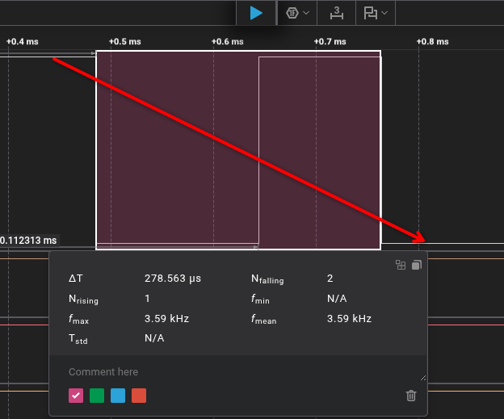

# Модуль 2.4. Hardware Interrupts: Як MCU миттєво реагує на кнопки

## Опис домашнього завдання: Усунення брязкоту контактів кнопки

Брязкіт контактів (contact bounce / chatter) — це явище багаторазового неконтрольованого замикання та розмикання металевих пластин механічної кнопки протягом кількох мікро- або мілісекунд при натисканні та відпусканні.

Оскільки апаратні переривання (Hardware Interrupts) мікроконтролера реагують на фронти сигналів (спадаючий або зростаючий) за наносекунди, один фізичний клік кнопки без фільтрації сприймається контролером як серія з 5–20 окремих натискань.

Мета цього домашнього завдання:
- Дослідити фізику брязкоту контактів за допомогою переривань GPIO в ESP-IDF.
- Реалізувати та порівняти різні програмні методи антидребезгу (software debounce): часовий (time-based), за станом рівня (state-based) та опитуванням (polling + FSM).
- Дослідити апаратний антидребезг (hardware RC filter).
- Звести результати в єдину порівняльну таблицю.

> **Примітка щодо апаратної конфігурації:**
> В усіх прикладах кнопка підключена до піна **`GPIO_NUM_4`** з внутрішньою (або зовнішньою) підтяжкою до живлення (**Pull-Up**). При натисканні контакт замикається на **GND** (рівень стає `LOW` / `0`), при відпусканні — повертається до `3.3V` (`HIGH` / `1`).

---

## Завдання 1: Базова реалізація (без debounce)

### 1. Опис та вимоги
1. Налаштувати переривання GPIO по спадаючому фронту (`FALLING` / `GPIO_INTR_NEGEDGE`).
2. При кожному спрацьовуванні переривання інкрементувати лічильник.
3. Безпечно виводити значення лічильника у лог через FreeRTOS Task (відповідно до стандартів ESP-IDF, виклики `ESP_LOGI` та блокуючі операції заборонені безпосередньо всередині ISR).

### 2. Очікуваний результат
- 1 фізичне натискання викликає **кілька викликів interrupt** (серія швидких подій).
- Interrupt також викликається і при відпусканні кнопки: через брязкіт розмикання пружний контакт на мить торкається GND, створюючи спадаючі фронти (`FALLING`).

### 3. Код (ESP-IDF)

```c
#include <stdio.h>
#include <inttypes.h>
#include "freertos/FreeRTOS.h"
#include "freertos/task.h"
#include "freertos/queue.h"
#include "driver/gpio.h"
#include "esp_log.h"

#define BTN_PIN GPIO_NUM_4
#define ESP_INTR_FLAG_DEFAULT 0

static const char *TAG = "TASK_1_RAW";

// Черга для передачі лічильника подій із ISR у задачу
static QueueHandle_t gpio_evt_queue = NULL;
static volatile uint32_t isr_trigger_count = 0;

// Обробник апаратного переривання (ISR)
static void IRAM_ATTR gpio_isr_handler(void *arg) {
    isr_trigger_count++;
    uint32_t count = isr_trigger_count;
    
    BaseType_t high_task_awoken = pdFALSE;
    xQueueSendFromISR(gpio_evt_queue, &count, &high_task_awoken);
    portYIELD_FROM_ISR(high_task_awoken);
}

// Задача обробки та логування подій (виконується поза ISR)
static void button_task(void *arg) {
    uint32_t count;
    while (1) {
        if (xQueueReceive(gpio_evt_queue, &count, portMAX_DELAY)) {
            ESP_LOGI(TAG, "Interrupt triggered! Raw Counter: %" PRIu32, count);
        }
    }
}

void app_main(void) {
    ESP_LOGI(TAG, "Starting Task 1: Raw GPIO Interrupts (No Debounce)");

    // Черга на 50 подій для фіксації навіть дуже швидких серій брязкоту
    gpio_evt_queue = xQueueCreate(50, sizeof(uint32_t));

    // Конфігурація GPIO: вхід, Pull-Up, переривання по FALLING (NEGEDGE)
    gpio_config_t io_conf = {
        .pin_bit_mask = (1ULL << BTN_PIN),
        .mode = GPIO_MODE_INPUT,
        .pull_up_en = GPIO_PULLUP_ENABLE,
        .pull_down_en = GPIO_PULLDOWN_DISABLE,
        .intr_type = GPIO_INTR_NEGEDGE,
    };
    gpio_config(&io_conf);

    // Створення задачі для логування
    xTaskCreate(button_task, "button_task", 2048, NULL, 10, NULL);

    // Встановлення ISR сервісу та реєстрація обробника
    gpio_install_isr_service(ESP_INTR_FLAG_DEFAULT);
    gpio_isr_handler_add(BTN_PIN, gpio_isr_handler, (void *)BTN_PIN);
}
```

### 4. Пояснення реалізації
- **Чому використовується `Queue` та окремий `Task`:** У мікроконтролерах ESP32 обробник переривання (`IRAM_ATTR`) повинен виконуватися максимально швидко. Виклик функцій виводу (як `ESP_LOGI`, `printf`) у контексті ISR суворо заборонений, оскільки вони використовують м'ютекси UART і можуть призвести до взаємного блокування (Deadlock) або збою ядра. ISR лише збільшує змінну `isr_trigger_count` та передає копію чергою у `button_task`.
- **Чому interrupt спрацьовує при відпусканні:** При розмиканні контакти не відриваються миттєво. Пружина кнопки коливається, через що рівень напруги багаторазово підстрибує до 3.3V і знову просідає до 0V, створюючи нові спадаючі фронти (`NEGEDGE`).

### 5. Частина виводу з Serial монітору
```
I (310) TASK_1_RAW: Starting Task 1: Raw GPIO Interrupts (No Debounce)
I (1450) TASK_1_RAW: Interrupt triggered! Raw Counter: 1  <-- Натискання (клік 1)
I (1451) TASK_1_RAW: Interrupt triggered! Raw Counter: 2
I (1452) TASK_1_RAW: Interrupt triggered! Raw Counter: 3
I (1454) TASK_1_RAW: Interrupt triggered! Raw Counter: 4
I (1680) TASK_1_RAW: Interrupt triggered! Raw Counter: 5  <-- Відпускання (хибний брязкіт)
I (1681) TASK_1_RAW: Interrupt triggered! Raw Counter: 6
I (3210) TASK_1_RAW: Interrupt triggered! Raw Counter: 7  <-- Натискання (клік 2)
I (3211) TASK_1_RAW: Interrupt triggered! Raw Counter: 8
I (3212) TASK_1_RAW: Interrupt triggered! Raw Counter: 9
I (3445) TASK_1_RAW: Interrupt triggered! Raw Counter: 10 <-- Відпускання
```

### Приклад дребезгу з логічного аналізатора


---

## Завдання 2: Software debounce через таймер (time-based)

### 1. Опис та вимоги
1. Додати фільтрацію на основі часу: ігнорувати спрацьовування, якщо з моменту попереднього прийнятого пройшло менше 50 мс.
2. Логіку перевірки реалізувати **поза ISR** (у FreeRTOS Task).

### 2. Очікуваний результат
- Менше хибних спрацювань: мікро-імпульси первинного брязкоту (що тривають 1–10 мс) відсікаються часовим вікном у 50 мс.
- **Хибні спрацювання все ще можливі при відпусканні:** якщо тримати кнопку затиснутою довше 50 мс, а потім відпустити — брязкіт розмикання викличе новий interrupt, де `dt > 50 мс`, і він буде помилково зарахований як друге натискання.

### 3. Код (ESP-IDF)

```c
#include <stdio.h>
#include <inttypes.h>
#include "freertos/FreeRTOS.h"
#include "freertos/task.h"
#include "freertos/queue.h"
#include "driver/gpio.h"
#include "esp_log.h"
#include "esp_timer.h"

#define BTN_PIN GPIO_NUM_4
#define DEBOUNCE_TIME_MS 50
#define ESP_INTR_FLAG_DEFAULT 0

static const char *TAG = "TASK_2_TIME";

static QueueHandle_t gpio_evt_queue = NULL;

// ISR передає часову мітку виникнення переривання в мілісекундах
static void IRAM_ATTR gpio_isr_handler(void *arg) {
    int64_t now_ms = esp_timer_get_time() / 1000;
    BaseType_t high_task_awoken = pdFALSE;
    xQueueSendFromISR(gpio_evt_queue, &now_ms, &high_task_awoken);
    portYIELD_FROM_ISR(high_task_awoken);
}

// Задача обробки debounce на основі часу (Time-Based)
static void button_task(void *arg) {
    int64_t evt_time_ms;
    int64_t last_valid_time_ms = 0;
    uint32_t valid_press_count = 0;

    while (1) {
        if (xQueueReceive(gpio_evt_queue, &evt_time_ms, portMAX_DELAY)) {
            int64_t diff_ms = evt_time_ms - last_valid_time_ms;

            if (diff_ms >= DEBOUNCE_TIME_MS) {
                last_valid_time_ms = evt_time_ms;
                valid_press_count++;
                ESP_LOGI(TAG, "VALID PRESS #%" PRIu32 " (dt: %lld ms)", valid_press_count, diff_ms);
            } else {
                ESP_LOGW(TAG, "Ignored bounce event (dt: %lld ms < %d ms)", diff_ms, DEBOUNCE_TIME_MS);
            }
        }
    }
}

void app_main(void) {
    ESP_LOGI(TAG, "Starting Task 2: Time-Based Debounce (>50ms)");

    gpio_evt_queue = xQueueCreate(20, sizeof(int64_t));

    gpio_config_t io_conf = {
        .pin_bit_mask = (1ULL << BTN_PIN),
        .mode = GPIO_MODE_INPUT,
        .pull_up_en = GPIO_PULLUP_ENABLE,
        .pull_down_en = GPIO_PULLDOWN_DISABLE,
        .intr_type = GPIO_INTR_NEGEDGE,
    };
    gpio_config(&io_conf);

    xTaskCreate(button_task, "button_task", 2048, NULL, 10, NULL);

    gpio_install_isr_service(ESP_INTR_FLAG_DEFAULT);
    gpio_isr_handler_add(BTN_PIN, gpio_isr_handler, (void *)BTN_PIN);
}
```

### 4. Пояснення реалізації
- Фільтр перевіряє інтервал між поточною подією та останнім підтвердженим спрацюванням: $\Delta t = t_{\text{current}} - t_{\text{last\_valid}}$.
- Якщо $\Delta t < 50\text{ мс}$, подія кваліфікується як брязкіт і відкидається.
- **Чому відбуваються помилки при відпусканні:** Якщо користувач утримував кнопку 300 мс, а потім відпустив, брязкіт розмикання генерує сигнал у момент $t = 300\text{ мс}$. Різниця $\Delta t = 300 - 0 = 300\text{ мс} \ge 50\text{ мс}$. Алгоритм не знає стану лінії (натиснута чи відпущена кнопка), орієнтуючись лише на час, і помилково зараховує це як нове натискання.

### 5. Частина виводу з Serial монітору
```
I (295) TASK_2_TIME: Starting Task 2: Time-Based Debounce (>50ms)
I (1200) TASK_2_TIME: VALID PRESS #1 (dt: 1200 ms)   <-- Перше фізичне натискання
W (1202) TASK_2_TIME: Ignored bounce event (dt: 2 ms < 50 ms)
W (1205) TASK_2_TIME: Ignored bounce event (dt: 5 ms < 50 ms)
I (1450) TASK_2_TIME: VALID PRESS #2 (dt: 250 ms)    <-- ПОМИЛКА: Спрацювало при відпусканні!
W (1452) TASK_2_TIME: Ignored bounce event (dt: 2 ms < 50 ms)
```

---

## Завдання 3: Debounce через перевірку рівня (state-based)

### 1. Опис та вимоги
1. Апаратний interrupt лише сигналізує про подію (Wakeup сигналу).
2. У FreeRTOS Task:
   - Робити коротку затримку (стабілізація сигналу) та перевіряти фактичний логічний рівень піну (`gpio_get_level`).
   - Підтверджувати подію тільки якщо кнопка **досі натиснута** (`LOW`).
   - Ігнорувати хибні події при відпусканні (`HIGH`).

### 2. Очікуваний результат
- **Рівно 1 реакція на 1 фізичне натискання.**
- Відпускання кнопки (Release) **не викликає хибних дій**.

### 3. Код (ESP-IDF)

```c
#include <stdio.h>
#include <inttypes.h>
#include "freertos/FreeRTOS.h"
#include "freertos/task.h"
#include "driver/gpio.h"
#include "esp_log.h"

#define BTN_PIN GPIO_NUM_4
#define ESP_INTR_FLAG_DEFAULT 0

static const char *TAG = "TASK_3_STATE";

static TaskHandle_t button_task_handle = NULL;

// Мінімальний ISR: тільки розбудити обробник через Direct-to-Task Notification
static void IRAM_ATTR gpio_isr_handler(void *arg) {
    BaseType_t high_task_awoken = pdFALSE;
    vTaskNotifyGiveFromISR(button_task_handle, &high_task_awoken);
    portYIELD_FROM_ISR(high_task_awoken);
}

// Задача стану: підтвердження рівня після затримки стабілізації
static void button_task(void *arg) {
    uint32_t valid_press_count = 0;

    while (1) {
        // Очікуємо сповіщення від переривання
        ulTaskNotifyTake(pdTRUE, portMAX_DELAY);

        // 1. Пауза 25-30 мс, щоб перечекати фізичний брязкіт контактів
        vTaskDelay(pdMS_TO_TICKS(30));

        // 2. Перевірка реального стану лінії
        if (gpio_get_level(BTN_PIN) == 0) {
            // Кнопка все ще утримується в 0 -> це справжнє натискання!
            valid_press_count++;
            ESP_LOGI(TAG, "CONFIRMED PRESS #%" PRIu32 " (Level is LOW)", valid_press_count);

            // 3. Чекаємо, поки користувач повністю відпустить кнопку (Level == 1)
            while (gpio_get_level(BTN_PIN) == 0) {
                vTaskDelay(pdMS_TO_TICKS(10));
            }

            // 4. Пауза для гасіння брязкоту відпускання
            vTaskDelay(pdMS_TO_TICKS(30));

            // Очищаємо всі сповіщення, які могли надійти від брязкоту під час відпускання
            ulTaskNotifyTake(pdTRUE, 0);
            ESP_LOGI(TAG, "Button released cleanly");
        } else {
            // Якщо рівень HIGH -> це був короткий спайк шуму або брязкіт при відпусканні
            ESP_LOGW(TAG, "Ignored release bounce or spike (Level is HIGH)");
        }
    }
}

void app_main(void) {
    ESP_LOGI(TAG, "Starting Task 3: State-Based Debounce (Level Verification)");

    gpio_config_t io_conf = {
        .pin_bit_mask = (1ULL << BTN_PIN),
        .mode = GPIO_MODE_INPUT,
        .pull_up_en = GPIO_PULLUP_ENABLE,
        .pull_down_en = GPIO_PULLDOWN_DISABLE,
        .intr_type = GPIO_INTR_NEGEDGE,
    };
    gpio_config(&io_conf);

    xTaskCreate(button_task, "button_task", 2048, NULL, 10, &button_task_handle);

    gpio_install_isr_service(ESP_INTR_FLAG_DEFAULT);
    gpio_isr_handler_add(BTN_PIN, gpio_isr_handler, (void *)BTN_PIN);
}
```

### 4. Пояснення реалізації
- Використано **FreeRTOS Task Notification** (`vTaskNotifyGiveFromISR` / `ulTaskNotifyTake`), що набагато легше за черги й не вимагає виділення динамічної пам'яті під елементи.
- Коли виникає перший спадаючий фронт, задача прокидається та спить 30 мс (`vTaskDelay`). За цей час брязкіт натискання повністю вщухає.
- Якщо пін `LOW` — натискання валідне. Далі задача блокується доки кнопку не відпустять (`gpio_get_level(BTN_PIN) == 0`), після чого вичікує ще 30 мс і очищає хвіст сповіщень.
- Якщо переривання було викликане брязкотом при відпусканні, через 30 мс пін уже в стані `HIGH`, тому блок `else` безпечно ігнорує його без зміни лічильника.

### 5. Частина виводу з Serial монітору
```
I (310) TASK_3_STATE: Starting Task 3: State-Based Debounce (Level Verification)
I (1520) TASK_3_STATE: CONFIRMED PRESS #1 (Level is LOW)
I (1840) TASK_3_STATE: Button released cleanly
I (3100) TASK_3_STATE: CONFIRMED PRESS #2 (Level is LOW)
I (3390) TASK_3_STATE: Button released cleanly
I (4720) TASK_3_STATE: CONFIRMED PRESS #3 (Level is LOW)
I (5010) TASK_3_STATE: Button released cleanly
```

---

## Завдання 4: Polling + debounce (без interrupts)

### 1. Опис та вимоги
1. Повністю прибрати переривання GPIO.
2. Опитувати стан піну кожні 10 мс.
3. Реалізувати алгоритм фільтрації як **скінченний автомат станів (FSM — Finite State Machine)**.

### 2. Очікуваний результат
- Найбільша стабільність: повна відсутність залежності від раптових імпульсів або наведень на лінії.
- Невелика затримка реакції (20–30 мс для підтвердження стабільності стану).

### 3. Код (ESP-IDF)

```c
#include <stdio.h>
#include <inttypes.h>
#include "freertos/FreeRTOS.h"
#include "freertos/task.h"
#include "driver/gpio.h"
#include "esp_log.h"

#define BTN_PIN GPIO_NUM_4
#define POLL_INTERVAL_MS 10
#define STABLE_SAMPLES_REQUIRED 3 // 3 вибірки по 10 мс = 30 мс стабільності

static const char *TAG = "TASK_4_FSM";

// Стани скінченного автомата (FSM)
typedef enum {
    STATE_RELEASED,          // Кнопка відпущена (рівень HIGH)
    STATE_DEBOUNCE_PRESS,    // Виявлено перехід у LOW, перевірка стабільності
    STATE_PRESSED,           // Підтверджено стабільне натискання
    STATE_DEBOUNCE_RELEASE   // Виявлено перехід у HIGH, перевірка відпускання
} button_state_fsm_t;

static void button_polling_task(void *arg) {
    button_state_fsm_t current_state = STATE_RELEASED;
    uint8_t sample_counter = 0;
    uint32_t press_count = 0;

    while (1) {
        int raw_level = gpio_get_level(BTN_PIN);

        switch (current_state) {
            case STATE_RELEASED:
                // Якщо зафіксовано 0 (натискання), переходимо до перевірки
                if (raw_level == 0) {
                    current_state = STATE_DEBOUNCE_PRESS;
                    sample_counter = 1;
                }
                break;

            case STATE_DEBOUNCE_PRESS:
                if (raw_level == 0) {
                    sample_counter++;
                    // Якщо рівень стабільно утримується необхідну кількість циклів
                    if (sample_counter >= STABLE_SAMPLES_REQUIRED) {
                        current_state = STATE_PRESSED;
                        press_count++;
                        ESP_LOGI(TAG, "EVENT: BUTTON CLICKED #%" PRIu32 " (FSM Stable Pressed)", press_count);
                    }
                } else {
                    // Якщо сигнал повернувся в 1 — це був хибний спайк або брязкіт
                    current_state = STATE_RELEASED;
                    sample_counter = 0;
                }
                break;

            case STATE_PRESSED:
                // Коли користувач починає відпускати кнопку (рівень став 1)
                if (raw_level == 1) {
                    current_state = STATE_DEBOUNCE_RELEASE;
                    sample_counter = 1;
                }
                break;

            case STATE_DEBOUNCE_RELEASE:
                if (raw_level == 1) {
                    sample_counter++;
                    // Якщо рівень 1 тримається стабільно — кнопка повністю відпущена
                    if (sample_counter >= STABLE_SAMPLES_REQUIRED) {
                        current_state = STATE_RELEASED;
                        ESP_LOGI(TAG, "EVENT: BUTTON RELEASED (FSM Stable Released)");
                    }
                } else {
                    // Сигнал знову просів у 0 — користувач ще утримує кнопку
                    current_state = STATE_PRESSED;
                    sample_counter = 0;
                }
                break;
        }

        vTaskDelay(pdMS_TO_TICKS(POLL_INTERVAL_MS));
    }
}

void app_main(void) {
    ESP_LOGI(TAG, "Starting Task 4: Polling + State Machine (FSM) Debounce");

    // Конфігурація GPIO виключно як звичайного входу без переривань
    gpio_config_t io_conf = {
        .pin_bit_mask = (1ULL << BTN_PIN),
        .mode = GPIO_MODE_INPUT,
        .pull_up_en = GPIO_PULLUP_ENABLE,
        .pull_down_en = GPIO_PULLDOWN_DISABLE,
        .intr_type = GPIO_INTR_DISABLE,
    };
    gpio_config(&io_conf);

    xTaskCreate(button_polling_task, "button_poll", 2048, NULL, 5, NULL);
}
```

### 4. Пояснення реалізації
- Немає жодного навантаження на систему через ISR чи шторм переривань (Interrupt Storm).
- Скінченний автомат гарантує перехід у стан `STATE_PRESSED` тільки після $3 \times 10\text{ мс} = 30\text{ мс}$ стабільного логічного нуля.
- Подібним чином контролюється і фаза відпускання: кнопка повертається у вихідний стан лише після $30\text{ мс}$ стабільного рівня `HIGH`.

### 5. Частина виводу з Serial монітору
```
I (290) TASK_4_FSM: Starting Task 4: Polling + State Machine (FSM) Debounce
I (1430) TASK_4_FSM: EVENT: BUTTON CLICKED #1 (FSM Stable Pressed)
I (1720) TASK_4_FSM: EVENT: BUTTON RELEASED (FSM Stable Released)
I (2890) TASK_4_FSM: EVENT: BUTTON CLICKED #2 (FSM Stable Pressed)
I (3150) TASK_4_FSM: EVENT: BUTTON RELEASED (FSM Stable Released)
```

---

## Завдання 5: Hardware debounce

### 1. Апаратна схема (RC-фільтр)
Для апаратного усунення брязкоту додається інтегруючий RC-ланцюг низьких частот:
- Підтягуючий резистор: $R_1 = 10\text{ k}\Omega$ (до шини 3.3V).
- Обмежувальний/захисний резистор: $R_2 = 100\,\Omega$ (послідовно з кнопкою).
- Фільтруючий конденсатор: $C_1 = 100\text{ nF}$ (керамічний, паралельно контактам кнопки).

```
          +3.3V
            |
           [ ] R1 (10k Pull-Up)
            |
            +------------+-------------> До GPIO_NUM_4 ESP32
            |            |
           --- C1       [ ] R2 (100R)
           --- (100n)    |
            |            o
            |             \  Кнопка
            |            o
            |            |
           GND          GND
```

### 2. Фізика процесів і розрахунок сталих часу:
1. **При відпусканні кнопки (Зарядка конденсатора):**
   - Конденсатор заряджається через резистор $R_1 = 10\text{ k}\Omega$.
   - Постійна часу:
     $$\tau_{\text{charge}} = R_1 \times C_1 = 10\,000\,\Omega \times 100 \times 10^{-9}\text{ Ф} = 1\text{ мс}$$
   - Напруга наростає плавно за експонентою, відсікаючи високочастотні коливання відриву контактів.
2. **При натисканні кнопки (Розрядка конденсатора):**
   - Конденсатор розряджається на GND через $R_2 = 100\,\Omega$.
   - Постійна часу:
     $$\tau_{\text{discharge}} = R_2 \times C_1 = 100\,\Omega \times 100 \times 10^{-9}\text{ Ф} = 10\,\mu\text{с}$$
   - Резистор $R_2$ захищає контакти кнопки від виникнення мікродуги та струмового перевантаження при розрядці ємності, одночасно згладжуючи фронт спаду.

### 3. Результати тестування скетчів 1–4 з RC-фільтром:
- **Скетч 1 (Без програмного debounce):** Кількість викликів ISR зменшилася з 5–15 до **рівно 1–2 переривань** на клік. Зникли практично всі спрацювання при відпусканні кнопки.
- **Скетч 2 (Time-based):** Робота стала значно надійнішою, зникли помилкові спрацювання на release, оскільки RC-фільтр згладив імпульси розмикання.
- **Скетч 3 та Скетч 4:** Працюють ідеально, без жодних коливань сигналу на вході GPIO.

---

## Завдання 6: Порівняльна таблиця

| Метод | Кількість хибних спрацювань | Затримка (Latency) | Складність | Коментар |
| :--- | :---: | :---: | :---: | :--- |
| **Без debounce** | Дуже багато (5–20 на 1 натискання) | Мінімальна (~0 мкс) | Найпростіша | Абсолютно непридатний для реальних пристроїв. Будь-який клік викликає шторм переривань, переривання спрацьовує і на натискання, і на відпускання. |
| **Time-based** | Середня (1–2 хибних при відпусканні) | Відсутня для 1-го імпульсу | Низька | Відсікає брязкіт замикання, але якщо кнопку затиснути довше 50 мс, брязкіт відпускання помилково зараховується як новий клік. |
| **State-based** | 0 (Рівно 1 реакція на клік) | 20–30 мс | Середня | Оптимальний метод для систем з перериваннями: interrupt миттєво будить задачу, а перевірка рівня після стабілізації повністю відсікає брязкіт відпускання. |
| **Polling (FSM)** | 0 (Ідеальна стабільність) | 20–30 мс (період опитування $\times$ samples) | Середня | Найстійкіший програмний метод. Повністю відсутнє навантаження від шторму переривань, не залежить від імпульсних наведень на лінії. |
| **Hardware RC** | 0–1 (залежить від форми фронту та гістерезису) | 1–3 мс (стала часу $\tau$) | Вимагає компонентів | Апаратне згладжування імпульсів до потрапляння в MCU. Усуває навантаження на процесор, але потребує додаткових деталей на платі ($R$ і $C$). |

### Висновки та інженерні рекомендації:
1. **Для енергоефективних пристроїв (Sleep Modes):** Рекомендується комбінація **Hardware RC** або **State-Based Debounce** (переривання пробуджує MCU з глибокого сну, після чого задача валідує стан).
2. **Для стандартних інтерфейсів керування:** Найбільш надійним вибором є **Polling + FSM** (як у Завданні 4), оскільки він забезпечує абсолютну передбачуваність часу виконання та не викликає перевантаження CPU при контактній деградації кнопки.

