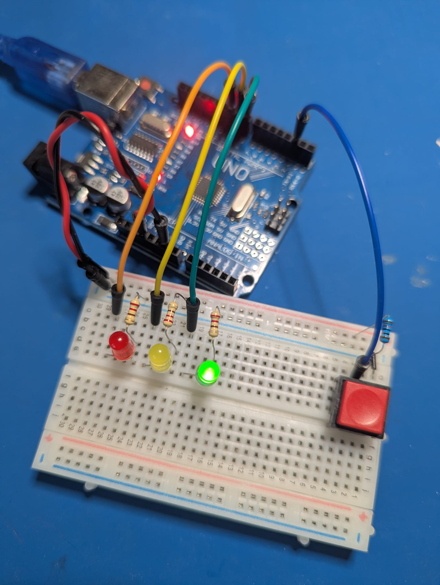

# Модуль 2.8. Мініпроєкт

## Домашнє завдання: Світлофор.

- Код і результат виконання на GitHub.
- Назва репозиторію (або гілка чи коміт меседж) повинна містити номер модуля і номер уроку.
- Посилання на репозиторій в LMS.
- Використовувати Arduino Framework або ESP-IDF.

### Задача

Використовуючи код із заняття додати стани відповідно до ПДР України.

Станом на 12 січня 2026 року в Україні правила дорожнього руху (ПДР) чітко регламентують послідовність сигналів світлофора для забезпечення безпеки.

Стандартна послідовність перемикання:
- Зелений: Дозволяє рух.
- Зелений миготливий: Попереджає, що час дії дозволеного сигналу закінчується і скоро буде ввімкнено заборонний сигнал.
- Жовтий: Забороняє рух і попереджає про майбутню зміну сигналів.
- Червоний: Забороняє рух.
- Червоний та жовтий одночасно: Попереджають про наступне ввімкнення зеленого сигналу (рух все ще заборонено).
- Зелений: Цикл повторюється.

#### Особливі випадки:

Жовтий миготливий: Дозволяє рух і інформує про наявність нерегульованого перехрестя або пішохідного переходу.


## Виконання

### Фото


### Скетч
```c
// Піни
const uint8_t RED_PIN = 10;
const uint8_t YELLOW_PIN = 9;
const uint8_t GREEN_PIN = 8;
const uint8_t BUTTON_PIN = 2; // Кнопка підключається між піном 2 та GND

// Тривалість фаз (у мілісекундах)
const unsigned long GREEN_TIME = 5000;         // Зелений: 5 с
const unsigned long BLINK_INTERVAL = 500;      // Інтервал миготіння: 0.5 с
const uint8_t BLINK_TOGGLES = 6;               // 3 миготіння зеленого (6 перемикань)
const unsigned long YELLOW_TIME = 2000;        // Жовтий: 2 с
const unsigned long RED_TIME = 5000;           // Червоний: 5 с
const unsigned long RED_YELLOW_TIME = 2000;    // Червоний + Жовтий: 2 с
const unsigned long DEBOUNCE_DELAY = 50;       // Захист від брязкоту кнопки: 50 мс

// Стани світлофора
enum TrafficState {
  STATE_GREEN,
  STATE_GREEN_BLINK,
  STATE_YELLOW,
  STATE_RED,
  STATE_RED_YELLOW,
  STATE_YELLOW_BLINK // Нерегульоване перехрестя (жовтий миготливий)
};

TrafficState currentState = STATE_GREEN;

unsigned long previousMillis = 0;
uint8_t blinkCounter = 0;
bool blinkLedState = HIGH;

// Змінні для обробки кнопки з антибрязкотом
bool lastButtonReading = HIGH;
bool buttonState = HIGH;
unsigned long lastDebounceTime = 0;

// Допоміжна функція для керування світлодіодами
void setLights(bool red, bool yellow, bool green) {
  digitalWrite(RED_PIN, red);
  digitalWrite(YELLOW_PIN, yellow);
  digitalWrite(GREEN_PIN, green);
}

void setup() {
  pinMode(RED_PIN, OUTPUT);
  pinMode(YELLOW_PIN, OUTPUT);
  pinMode(GREEN_PIN, OUTPUT);
  pinMode(BUTTON_PIN, INPUT_PULLUP); // Внутрішня підтяжка до 5V
  // Початковий стан: Зелений
  setLights(LOW, LOW, HIGH);
  previousMillis = millis();
}

void handleButton(unsigned long currentMillis) {
  bool reading = digitalRead(BUTTON_PIN);
  // Якщо стан піна змінився (через натискання або шум), скидаємо таймер
  if (reading != lastButtonReading) {
    lastDebounceTime = currentMillis;
  }
  // Якщо стан стабільний довше ніж DEBOUNCE_DELAY
  if ((currentMillis - lastDebounceTime) > DEBOUNCE_DELAY) {
    if (reading != buttonState) {
      buttonState = reading;
      // Кнопку натиснуто (активний рівень LOW завдяки INPUT_PULLUP)
      if (buttonState == LOW) {
        previousMillis = currentMillis;
        if (currentState != STATE_YELLOW_BLINK) {
          // Увімкнення режиму «Жовтий миготливий»
          currentState = STATE_YELLOW_BLINK;
          blinkLedState = HIGH;
          setLights(LOW, blinkLedState, LOW);
        } else {
          // Повернення до стандартного циклу (починаємо з зеленого)
          currentState = STATE_GREEN;
          setLights(LOW, LOW, HIGH);
        }
      }
    }
  }
  lastButtonReading = reading;
}

void loop() {
  unsigned long currentMillis = millis();
  // Опитування кнопки без блокування
  handleButton(currentMillis);

  switch (currentState) {
    // 1. Зелений: Дозволяє рух
    case STATE_GREEN:
      if (currentMillis - previousMillis >= GREEN_TIME) {
        previousMillis = currentMillis;
        currentState = STATE_GREEN_BLINK;
        blinkCounter = 0;
        blinkLedState = LOW;
        setLights(LOW, LOW, blinkLedState);
      }
      break;
    // 2. Зелений миготливий
    case STATE_GREEN_BLINK:
      if (currentMillis - previousMillis >= BLINK_INTERVAL) {
        previousMillis = currentMillis;
        blinkCounter++;
        if (blinkCounter < BLINK_TOGGLES) {
          blinkLedState = !blinkLedState;
          setLights(LOW, LOW, blinkLedState);
        } else {
          currentState = STATE_YELLOW;
          setLights(LOW, HIGH, LOW);
        }
      }
      break;
    // 3. Жовтий: Забороняє рух і попереджає про зміну
    case STATE_YELLOW:
      if (currentMillis - previousMillis >= YELLOW_TIME) {
        previousMillis = currentMillis;
        currentState = STATE_RED;
        setLights(HIGH, LOW, LOW);
      }
      break;
    // 4. Червоний: Забороняє рух
    case STATE_RED:
      if (currentMillis - previousMillis >= RED_TIME) {
        previousMillis = currentMillis;
        currentState = STATE_RED_YELLOW;
        setLights(HIGH, HIGH, LOW);
      }
      break;
    // 5. Червоний та жовтий одночасно
    case STATE_RED_YELLOW:
      if (currentMillis - previousMillis >= RED_YELLOW_TIME) {
        previousMillis = currentMillis;
        currentState = STATE_GREEN;
        setLights(LOW, LOW, HIGH);
      }
      break;
    // 6. Жовтий миготливий (Нерегульоване перехрестя)
    case STATE_YELLOW_BLINK:
      if (currentMillis - previousMillis >= BLINK_INTERVAL) {
        previousMillis = currentMillis;
        blinkLedState = !blinkLedState;
        setLights(LOW, blinkLedState, LOW);
      }
      break;
  }
}
```
